I'm a third-year Software Engineering undergraduate at NSBM Green University. Most of what I build starts with a job I'm tired of doing by hand, like filling Excel sheets, hunting for internships or reviewing my own code. I turn it into an app or an agent that does the job for me.

Right now I'm focused on **AI agents**, **RAG** and **mobile apps with AI built in**.

| Project | What it does | Built with |
|---|---|---|
| **[Design Library MCP](https://github.com/Ashan-Iduranga/design-library-mcp)** | A local library of real UI references, served to Claude as an MCP server with a browsable gallery. | MCP, Claude Code |
| **[Agentic Dev Workflow]** | Reusable agent workflow for code review, a custom test runner and security checks. | Claude Code, GitHub Actions |
| **[MemoStack](https://github.com/Ashan-Iduranga/memostack)** | Note-sharing app with streaks, XP and note requests. | React Native, Firebase, Cloudinary |
| **[Daily Strip](https://github.com/Ashan-Iduranga/expense-tracker)** | Minimal expense tracker with charts, budgets and offline storage, plus a landing page. | Expo, TypeScript, Vercel |
| **[BOQ Filler]** | Desktop tool that fills a second Excel sheet from a BOQ by item number. Sold as a licensed product. | Python |

<picture>
  <source media="(prefers-color-scheme: dark)" srcset="https://raw.githubusercontent.com/Ashan-Iduranga/Ashan-Iduranga/output/snake-dark.svg"/>
  <source media="(prefers-color-scheme: light)" srcset="https://raw.githubusercontent.com/Ashan-Iduranga/Ashan-Iduranga/output/snake.svg"/>
  
</picture>

